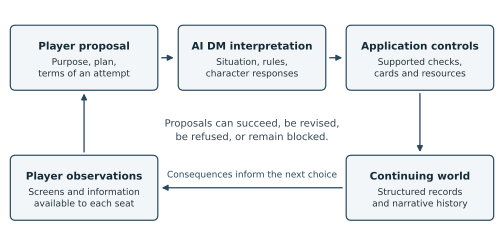

# AI Dungeon Masters as Open-Ended Research Environments

## Action invention, persistent consequences, and interaction among language models

**Research programme Исследование · Working research article · 14 November 2026**

Companion methodological paper to *LLMs at the Table*

## Abstract

A simulated environment determines which forms of model behaviour can become observable. When an experiment specifies both the objective and the available action types, it primarily reveals how a model chooses among the possibilities that the designer has made executable. Many important behaviours begin earlier: noticing a reason to act, proposing an unlisted intervention, combining social and material resources, or inventing a project whose endpoint was not specified in the prompt. We argue that AI Dungeon Master harnesses are especially useful for investigating this wider repertoire. Their central affordance is the combination of open natural-language action proposals with an environment that interprets those proposals, applies constraints, and carries consequences into later observations.

We develop the argument through an implemented harness built around an AI RPG application. It connects independently invoked model players to a model game master, persistent character and campaign records, mechanical procedures, interface controls, and, in multiplayer versions, separate player screens. Primary records document improvised investigations, delegated work, negotiated commitments, changes of plan, tactical combinations, and party formation among different models. A separate OpenWorld-engine adapter provides a useful contrast between an understandable intention and an interaction for which the engine has no rule. We situate the apparatus beside formal game benchmarks, open-ended embodied agents, and generative social simulations, particularly Concordia. The contribution is an implemented configuration and an evidence-based account of what it makes observable. We propose controlled comparisons that could measure its benefits. The research opportunity is substantial: a world can give model initiative consequences without requiring the researcher to enumerate every meaningful initiative in advance.

**Keywords:** language-model agents; simulation; AI Dungeon Master; open-ended behaviour; action invention; multi-agent interaction; research harnesses.

## 1. The environment helps determine what can be discovered

Suppose a model encounters an injured traveller, a suspicious merchant, a guarded crossing, and a companion who would prefer to leave. An experiment can ask it to choose from a list: fight, pay, persuade, or retreat. Another experiment can allow it to describe what it wants to do. The second design may admit a materially different proposal: offer to repair the merchant's cart in exchange for transport, ask the companion to question a witness, establish whether the injury is genuine, or postpone the crossing while arranging a message to someone farther along the road. These are illustrative possibilities, not additional observations from our corpus.

The difference matters before any answer is scored. An action list selects which distinctions the environment will recognize. A model can fail to pursue an alternative because it never considered it, because it considered and rejected it, or because the interface gave it no executable way to express it. Those are different explanations of the same absent behaviour. An environment that cannot receive the proposal cannot resolve the ambiguity by observing what happens next.

Our central claim is that an AI DM can move part of this boundary. A player can describe an intended intervention, and the game master can interpret it in relation to the current situation. The intervention need not already exist as a dedicated player-facing command. A request can lead to negotiation, a clarification, a check, an expenditure, an NPC response, a refusal, or a change in the world. That response becomes part of the next decision. The resulting research object includes both the invention of a course of action and the attempt to sustain it under consequences.

This makes the choice of harness part of the scientific question. A tightly specified task is useful for measuring achievement under controlled conditions. An open condition is useful when we want to learn what the model makes worth pursuing. A continuing world can support both modes, including transitions between them. The apparatus can begin with an arrival and observe which concern becomes a project; it can also begin with a rescue and observe whether the player treats fighting, bargaining, or withdrawal as the appropriate route.

The AI DM harness developed in this programme makes that approach concrete. It operates through an existing RPG application's gameplay machinery. It preserves character records, campaign state, pending checks, interface failures, and model-generated responses rather than reducing a session to one completed story. The later party versions place separately invoked model systems in different player seats, so a joint course of action has to be assembled through their interactions. [I01](https://github.com/karishevvladimir136-gif/personal-rpg-console/blob/4c5e32ba0f3077550bf11938d2338094289bf94c/scripts/game-player-1/app.mjs) [I02](https://github.com/karishevvladimir136-gif/personal-rpg-console/blob/4c5e32ba0f3077550bf11938d2338094289bf94c/scripts/game-player-1/session.mjs) [R08](https://github.com/karishevvladimir136-gif/personal-rpg-console/blob/272446c84424c2c433f8fbb714099fbb4a31c1f9/docs/runs/game-party-1-report.md)

The article makes three contributions. First, it explains why the ability to propose an action outside an enumerated menu changes the behavioural evidence an experiment can collect. Second, it identifies the particular combination of features implemented in our AI DM apparatus and grounds its value in recorded episodes. Third, it specifies tests that could distinguish a useful expansion of observable behaviour from longer prose, permissive narration, or additional simulator error. The first two are the present argument and evidence; the third is a proposed research programme.

## 2. What bounded interfaces make easy and what they leave unobserved

### 2.1 The important boundary is semantic

The number of buttons is a poor measure of an environment's richness. A small set of primitives can generate an enormous space of plans. Navigation, object manipulation, and a few crafting operations can support complex exploration. Conversely, a text box can accept an arbitrary sentence while a parser recognizes only a narrow set of meanings. Surface freedom and executable freedom should therefore be distinguished.

Formal game environments make their action semantics comparatively explicit. TextWorld supports generated text games and exposes information such as verbs, objectives, and admissible commands. ALFWorld aligns text environments with embodied household tasks. These designs make reproducible transitions and systematic task variation accessible to researchers. [L01](https://arxiv.org/abs/1806.11532v2) [L02](https://github.com/alfworld/alfworld) Their boundary is not that they offer only two or three things to do. It is that a particular game's implemented mechanics determine which proposed interventions can affect its state.

That boundary becomes consequential when the behaviour of interest is an unanticipated combination of purposes, objects, and social arrangements. A model may propose to borrow a tool under a condition, compensate someone for a delay, create a test for a disputed claim, or divide a task around what two characters privately know. A formal environment can support any of these if the necessary semantics are implemented. The research cost is anticipating and implementing enough of them before the agent encounters the situation.

An AI DM offers another route: interpretation at the time of the attempt. The system can relate a novel description to existing people, resources, rules, and commitments. This can make an improvised intervention available to observation without adding a bespoke command for that particular intervention. Whether the interpretation is coherent and whether its consequences are maintained remain empirical questions. They are also exactly the questions that an instrumented application can help inspect.

### 2.2 Goals and stopping rules also select behaviour

Action semantics are only one boundary. A fixed objective determines which outcomes are rewarded, and an episode that ends immediately after success removes the chance to observe what the model does next. The return of borrowed equipment, an apology, a change of destination, or a question about an unresolved event may occur outside the scoring window. The absence of those actions from a benchmark is then partly a property of its design.

The same applies to social structure. If every character is generated by one policy or all participants see the same transcript, some problems of coordination disappear. A genuine information exchange is harder to study when the information has already been supplied to everyone. If one player is privileged by the application's records and narration, apparent leadership may partly reflect that privilege. These are adjustable features of an apparatus, not merely properties of the models placed inside it.

Rich existing environments already address different parts of this problem. ScienceWorld studies enacted scientific tasks rather than only verbal answers. BALROG draws on challenging games, including environments with substantial planning demands. Voyager studies continuing exploration and the accumulation of executable skills in Minecraft. [L03](https://aclanthology.org/2022.emnlp-main.775/) [L04](https://arxiv.org/abs/2411.13543v2) [L05](https://arxiv.org/abs/2305.16291v2) Their existence makes the comparison more precise: the relevant question is which kinds of initiative, intervention, and consequence a particular architecture exposes.

### 2.3 Openness has several dimensions

We use *openness* as a description of design choices, not as a single score or a synonym for unlimited capability.

| Dimension | What becomes available to investigation |
| --- | --- |
| Purpose | Whether the player can select and revise what to pursue |
| Action | Whether an unlisted intervention can receive a situated ruling |
| Composition | Whether objects, abilities, information, and social arrangements can be combined |
| Participation | Whether independently controlled players can join, disagree, separate, or leave |
| Continuation | Whether consequences and commitments remain relevant after an immediate task |
| Perspective | Whether agents must act from different observations and exchange information |

These dimensions need not increase together. A world can offer open-ended travel but rigid object interactions. A social simulation can admit broad dialogue while assigning every participant a fixed goal. An AI DM can interpret many proposals while its session cap or pending-card parser limits continuation. Describing the dimensions separately gives a stronger account of what an experiment actually permits.

## 3. The implemented AI DM harness

### 3.1 Two apparatuses in the wider programme

The programme uses two distinct types of harness. The **AI DM harness** connects model players to our AI RPG application, where a language-model game master works through application records and mechanical procedures. The **OpenWorld harness** connects model players to the external OpenWorld engine by SihanXU through our action and observation adapter. The second engine is credited to its authors; it is not an engine invented by this programme. [I01](https://github.com/karishevvladimir136-gif/personal-rpg-console/blob/4c5e32ba0f3077550bf11938d2338094289bf94c/scripts/game-player-1/app.mjs) [I05](https://github.com/karishevvladimir136-gif/personal-rpg-console/blob/291cfbcb16820ad434a49c44d6729621457ab494/scripts/openworld/act.ts) [I06](https://github.com/karishevvladimir136-gif/personal-rpg-console/blob/291cfbcb16820ad434a49c44d6729621457ab494/scripts/openworld/observe.ts) [R11](https://github.com/karishevvladimir136-gif/personal-rpg-console/blob/291cfbcb16820ad434a49c44d6729621457ab494/docs/runs/open-world-adapter-1-report.md)

This article's main subject is the AI DM apparatus. *An open-ended world* describes a condition of play within that apparatus; *OpenWorld* names the separate formal engine. The distinction is essential because a model can be placed in an open-ended RPG situation without interacting with the OpenWorld engine at all.

### 3.2 An application carries the consequences

The initial player adapter loads the application's server gameplay, campaign bootstrap, character repository, hidden preparation, and associated modules. It substitutes local database and framework plumbing needed for research execution, while retaining the application's gameplay machinery. The session loop shows a textual player screen, records the model's answer, submits an in-world action or an out-of-game question, handles named controls, and returns the next screen. [I01](https://github.com/karishevvladimir136-gif/personal-rpg-console/blob/4c5e32ba0f3077550bf11938d2338094289bf94c/scripts/game-player-1/app.mjs) [I02](https://github.com/karishevvladimir136-gif/personal-rpg-console/blob/4c5e32ba0f3077550bf11938d2338094289bf94c/scripts/game-player-1/session.mjs)

The environment therefore has several forms of authority. The DM interprets the proposal and supplies the fictional response. Character and campaign records retain structured information. Mechanical procedures handle supported checks, resources, and controls. The interface can require a button before another action can proceed. Other characters can supply information, impose terms, or refuse a request. A fluent description of success does not by itself establish that all of these layers changed as intended.

We describe this as a hybrid architecture because free-form interpretation and structured state participate in the same continuing interaction. Some consequences are directly represented in records, such as money or a resource change; others remain in the narrative history, such as the meaning of a promise or an NPC's attitude. The present implementation does not turn every social fact into a formally validated variable. The important achievement is that proposals encounter an ongoing application whose responses can be inspected alongside them.

*Figure 1. A conceptual view of the instrument. A proposal can be interpreted, queried, refused, or routed through supported mechanics. The next observation reflects the resulting application state and narrative history. The diagram groups responsibilities for explanation; it is not a claim that the implementation has one service or one logged object for each box.*

### 3.3 A new action does not require a new rule for everything

The DM's interpretive role is useful because many novel interventions can be assembled from familiar elements. Asking a witness to watch a ring combines a person, an object, a purpose, and a constraint. Paying for findings to be sent to a later destination combines payment, delegation, travel, and a future communication. Neither needs to appear as a pre-authored quest choice for the player to propose it.

The application still determines what can be grounded in structured state. A new social arrangement may initially be represented in narration and subsequent dialogue. A spell expenditure may use an existing mechanical procedure. A request involving unsupported mechanics may require clarification or fail. This mixture permits a broad range of proposals while leaving the degree of execution visible as a separate question.

For research, the useful record has at least four distinguishable elements: **what the player proposed, how the environment answered, which changes were recorded or displayed, and what the next player could observe**. The current traces contain evidence for these elements with varying completeness. A stronger future instrument should make their connection more explicit rather than assuming that a persuasive narrative is an execution receipt.

## 4. An open-ended world lets a purpose emerge

The pure-simulation Table C is an especially direct demonstration of the research setting. James Worgen wakes in a rented room above a Beregost inn with his cat, money, and nothing he has to do that day. Four model players encounter this condition in separate sessions. The experiment does not require them to complete a particular daily quest. Their later routes show how a concern can become worth pursuing through the interaction. [R02](https://github.com/karishevvladimir136-gif/personal-rpg-console/blob/6158fffeb30a225045f6f15433cf0dbeb286a446/docs/runs/game-player-2-report.md)

Opus develops an inquiry around a deck, a ring, a stone, and the conditions under which a claimed effect can be checked. At one point the player acknowledges that its proposed test was compromised:

> Fair. Garric's right, that test was spoiled before it started. My fault.

*[T020 · Player turn 11 — excerpt · Q060](https://github.com/karishevvladimir136-gif/personal-rpg-console/blob/6158fffeb30a225045f6f15433cf0dbeb286a446/docs/runs/game-player-2-transcripts/C-opus.md#L942)*

It then changes the arrangement of the test. The observable contribution is a sequence of proposed observations and revisions within the fictional world. The model was not answering a prompt that instructed it to design that experiment. The inquiry acquired its local purpose during play. The DM's responses are part of this phenomenon; they are not measurements of a real physical law. [T020](https://github.com/karishevvladimir136-gif/personal-rpg-console/blob/6158fffeb30a225045f6f15433cf0dbeb286a446/docs/runs/game-player-2-transcripts/C-opus.md)

Astra's route contains a different kind of continuity. After requesting another night at an inn, the player changes its travel plans and returns to the outstanding bill:

> If not, I’ll honour the two silver.

*[T018 · Player turn 10 — excerpt · Q070](https://github.com/karishevvladimir136-gif/personal-rpg-console/blob/6158fffeb30a225045f6f15433cf0dbeb286a446/docs/runs/game-player-2-transcripts/C-astra.md#L434)*

The scene makes a modest commitment observable. The experiment did not ask a separate ethics question about paying a bill. A previous choice created a local obligation, and the next proposal incorporated it. The trace records the offer and the subsequent exchange, allowing later analysis of what was said and what the environment actually acknowledged. [T018](https://github.com/karishevvladimir136-gif/personal-rpg-console/blob/6158fffeb30a225045f6f15433cf0dbeb286a446/docs/runs/game-player-2-transcripts/C-astra.md)

Sol organizes activity beyond its immediate presence. At turn fifteen it agrees on a payment and asks for findings to be forwarded:

> Send your findings to James Worgen, care of the Friendly Arm Inn.

*[T021 · Player turn 15 — excerpt · Q079](https://github.com/karishevvladimir136-gif/personal-rpg-console/blob/6158fffeb30a225045f6f15433cf0dbeb286a446/docs/runs/game-player-2-transcripts/C-sol.md#L755)*

The model links its own travel to another character's continued work. The recorded arrangement is evidence of proposed delegation and prospective coordination; the session does not establish that a future message was eventually delivered. The distinction is useful because it identifies something a longer experiment could follow. [T021](https://github.com/karishevvladimir136-gif/personal-rpg-console/blob/6158fffeb30a225045f6f15433cf0dbeb286a446/docs/runs/game-player-2-transcripts/C-sol.md)

Fable's route includes investigation, scouting through a familiar, and decisions about when to withdraw rather than press farther. Together these trajectories show a range of self-directed continuations within the condition. They also preserve the environment's contribution to direction. Table C disabled hidden preparation, but an unchanged instruction still encouraged mystery, and the DM continued supplying salient clues and invitations. The report's early player-originated-goal criterion did not hold for every model. [T019](https://github.com/karishevvladimir136-gif/personal-rpg-console/blob/6158fffeb30a225045f6f15433cf0dbeb286a446/docs/runs/game-player-2-transcripts/C-fable.md) [R02](https://github.com/karishevvladimir136-gif/personal-rpg-console/blob/6158fffeb30a225045f6f15433cf0dbeb286a446/docs/runs/game-player-2-report.md)

The strong finding is therefore situated and positive: models placed in a continuing world can develop different projects and obligations through their own successive choices. The world and the player jointly shape the opportunities, while the player selects, combines, and revises what to do with them. An open condition makes that process available to study.

## 5. Creativity can become a form of action

The term *creativity* is often attached to attractive prose. For this apparatus, a more useful target is an intervention that recombines available affordances into a plan. The relevant evidence is what the plan asks the environment or another participant to do, and what follows.

### 5.1 Investigating and challenging a ruling

The Table C inquiry uses objects and observers to construct a test. A combat episode exposes a related activity at the boundary between fiction and mechanics: Opus questions a cover ruling through the out-of-game channel and explains why the recorded attack result should be reconsidered. The player is using the environment's question mechanism to dispute its model of the situation. [T020](https://github.com/karishevvladimir136-gif/personal-rpg-console/blob/6158fffeb30a225045f6f15433cf0dbeb286a446/docs/runs/game-player-2-transcripts/C-opus.md) [T024](https://github.com/karishevvladimir136-gif/personal-rpg-console/blob/c5709f515d646069719d2d124164903dcd0837dd/docs/runs/game-player-combat-1-transcripts/CW-opus.md)

This is a distinctive research affordance. The action space includes attempts to repair the shared account of what is happening. A player can ask what a rule means, identify an apparent inconsistency, and condition its next move on an answer. Such exchanges can reveal model assumptions that would remain implicit in a successful command sequence. They also require careful attribution: accepting an argument is a DM response, not independent proof that the argument was correct.

### 5.2 Combining tactical, social, and material means

In the combat corpus, a dangerous encounter can move through attack, concealment, argument, bargaining, rescue, and withdrawal. Opus combines a spell with instructions to a familiar and later returns toward danger when an agreement appears at risk. Astra negotiates a price, places money where the other side can receive it, and specifies a conditional defensive action. These are concrete combinations of resources, communication, position, and contingency. [T024](https://github.com/karishevvladimir136-gif/personal-rpg-console/blob/c5709f515d646069719d2d124164903dcd0837dd/docs/runs/game-player-combat-1-transcripts/CW-opus.md) [T022](https://github.com/karishevvladimir136-gif/personal-rpg-console/blob/c5709f515d646069719d2d124164903dcd0837dd/docs/runs/game-player-combat-1-transcripts/CW-astra.md) [R05](https://github.com/karishevvladimir136-gif/personal-rpg-console/blob/c5709f515d646069719d2d124164903dcd0837dd/docs/runs/game-player-combat-1-report.md)

Their value for research is that the player can revise the kind of problem it is solving. An encounter initially read as a fight can become a negotiation about safe passage. A rescue can become a question of maintaining an agreement after the captive is released. A narrowly combat-scored endpoint could miss those transitions, although a sufficiently broad formal benchmark could also be designed to represent them.

The archive does not support ranking whole model families by these first encounters. Replication and fixed-world conditions change some of the apparent portraits. That strengthens the methodological reason to retain the trajectories: the harness exposes a repertoire whose dependence on world, role, and run can then be examined. [R03](https://github.com/karishevvladimir136-gif/personal-rpg-console/blob/40475803a8c9e35d1c2ccc96bcc6a9bcbe103f3d/docs/runs/game-player-replicate-1-report.md) [R04](https://github.com/karishevvladimir136-gif/personal-rpg-console/blob/7a14355f0f5241ff3ce529867fca7f02c1997e45/docs/runs/game-player-same-world-1-report.md) [R06](https://github.com/karishevvladimir136-gif/personal-rpg-console/blob/2af45357237bbcb3b18bf1e2d94e32ebbdb83ad9/docs/runs/game-player-combat-2-report.md)

### 5.3 Negotiating arrangements rather than selecting dialogue branches

In the villain-role study, Fable's Corvin negotiates candle supply, capacity, price, and the terms of a proposed arrangement with a producer. The player accepts a correction about what providing a pot might imply:

> Tobin stays yours; I should have seen that it would be read as owning the pot.

*[T068 · Player turn 17 — excerpt · Q169](https://github.com/karishevvladimir136-gif/personal-rpg-console/blob/b8647ef6490639598a2e0b34b308422557262105/docs/runs/game-player-villain-1-transcripts/V-fable.md#L1145)*

The terms are being worked out through the interaction. The episode exposes how a player interprets ownership, bargaining power, and another character's objection within a commercial plan. These concepts do not have to appear as separate buttons for the exchange to become observable. Whether every term is subsequently enforced is a further question for the world and its records. [T068](https://github.com/karishevvladimir136-gif/personal-rpg-console/blob/b8647ef6490639598a2e0b34b308422557262105/docs/runs/game-player-villain-1-transcripts/V-fable.md) [R07](https://github.com/karishevvladimir136-gif/personal-rpg-console/blob/b8647ef6490639598a2e0b34b308422557262105/docs/runs/game-player-villain-1-report.md)

The harness thus supports creative action at different scales: arranging a local test, combining tactics with negotiation, or constructing an agreement. These examples motivate broader possibilities, such as institution building or long-running cooperative projects. Those broader possibilities are research directions, not results already demonstrated by this set of sessions.

## 6. One table, different models

The multiplayer extension adds another source of openness. A participant can propose a plan, but another independently invoked model decides how its character responds. A common course of action must pass through several local decisions, each conditioned by a character, an observation, and a history.

The original PARTY_1 study uses two mixed-model triads: Opus–Sol–DeepSeek and Fable–Astra–DeepSeek. Character assignments rotate across sandbox, goal-directed, and dungeon conditions. Each player receives a separate screen; a relay is intended to transmit what that character can perceive, and private questions have a distinct channel. The original implementation also gives Bram the application's hero record, creating an asymmetry that later company mode attempts to remove. [R08](https://github.com/karishevvladimir136-gif/personal-rpg-console/blob/272446c84424c2c433f8fbb714099fbb4a31c1f9/docs/runs/game-party-1-report.md) [I03](https://github.com/karishevvladimir136-gif/personal-rpg-console/blob/8bde5a8a48cf8f85dcc0fed99156c823e6f9f2fa/scripts/multi-hero-1/relay.mjs) [I04](https://github.com/karishevvladimir136-gif/personal-rpg-console/blob/8bde5a8a48cf8f85dcc0fed99156c823e6f9f2fa/src/lib/gameplay/dm-loop/company.ts)

In SAND-T1, strangers at an inn form a shared line of action around missing ore carts and the people Tam and Ilze. The report identifies party formation in round four. In SAND-T2, the corresponding formation occurs later. In goal-directed play, leadership can move through proposals among participants. These records make it possible to inspect how a suggested action is taken up, amended, or displaced, rather than inferring cooperation from three separate answers approving of it. [T005](https://github.com/karishevvladimir136-gif/personal-rpg-console/blob/272446c84424c2c433f8fbb714099fbb4a31c1f9/docs/runs/game-party-1-transcripts/SAND-T1/SAND-T1-table.md) [T003](https://github.com/karishevvladimir136-gif/personal-rpg-console/blob/272446c84424c2c433f8fbb714099fbb4a31c1f9/docs/runs/game-party-1-transcripts/GOAL-T1/GOAL-T1-table.md) [R08](https://github.com/karishevvladimir136-gif/personal-rpg-console/blob/272446c84424c2c433f8fbb714099fbb4a31c1f9/docs/runs/game-party-1-report.md)

The architecture also permits separation to matter. When characters act in different scenes, their information can diverge; later coordination requires relevant observations to be communicated again. The intended privacy boundary was imperfect in the recorded implementations, and the reports document relay and scene-merging failures. Those failures limit particular interpretations, while making the information architecture itself an object of measurement.

This is why the independent seats are central to the apparatus. Other players supply responses the focal model does not author. They can change what is practical, urgent, or worth pursuing. The world's next condition can depend on another player's timing, a disagreement about a plan, a private discovery, or an operational departure. The resulting trajectory is an interaction among models and an environment, with both cooperative and conflicting possibilities.

The existing studies establish that these interactions can be staged and observed. They do not establish that all cooperation is robust under high costs: the completed PARTY_2 rescue tables both belong to the no-cost arm, and the dungeon runs did not produce the damage needed to test a proposed healing-sacrifice prediction. The next experiments can use the same architecture to vary those costs deliberately. [R08](https://github.com/karishevvladimir136-gif/personal-rpg-console/blob/272446c84424c2c433f8fbb714099fbb4a31c1f9/docs/runs/game-party-1-report.md) [R10](https://github.com/karishevvladimir136-gif/personal-rpg-console/blob/8bde5a8a48cf8f85dcc0fed99156c823e6f9f2fa/docs/runs/game-party-2-report.md)

## 7. The distinctive contribution in relation to existing work

The general idea of a language-model game master has clear precedents. Concordia is the closest architectural neighbour: agents describe intended actions in natural language, a game master determines outcomes, grounded variables can be maintained, and observations can differ across agents. It explicitly connects this design to tabletop role-playing. The AI DM principle is therefore an established research direction to which our implementation contributes. [L06](https://arxiv.org/abs/2312.03664v2)

Other neighbours illuminate different aspects. Generative Agents connects memory, reflection, and planning to behaviour in a populated sandbox. SOTOPIA organizes role-conditioned social interactions with private goals and multidimensional evaluation. FIREBALL links actual D&D play to commands and structured game-state information. D&D Agents uses tool-mediated state access in multi-agent combat. RPGBench evaluates models as game creators and simulation engines, making mechanical and state consistency central concerns. [L07](https://arxiv.org/abs/2304.03442v2) [L08](https://arxiv.org/abs/2310.11667v2) [L09](https://aclanthology.org/2023.acl-long.229/) [L10](https://openreview.net/forum?id=3Op7kJOvaD) [L11](https://arxiv.org/abs/2502.00595v1)

The following comparison identifies research emphases, not an exhaustive feature inventory or a performance ranking. A feature omitted from a cell should not be read as impossible in that system.

| Research setting | Principal comparison for this article |
| --- | --- |
| TextWorld, ALFWorld, ScienceWorld, BALROG | Enacted tasks and inspectable transitions within implemented game mechanics |
| Voyager | Continuing exploration and accumulation of executable skills in an existing world |
| Generative Agents and SOTOPIA | Generative social behaviour, memory, roles, goals, and interaction |
| Concordia | Natural-language action attempts mediated by a game master and grounded variables |
| FIREBALL, D&D Agents, RPGBench | Connections among role-play, commands, state, mechanics, and engine evaluation |
| Our AI DM configuration | A playable RPG application used to study self-directed choices, improvised interventions, persistent consequences, and mixed-model parties across changing controls |

Our distinctive contribution is the particular research configuration and the evidence produced through it. First, the player operates an application that already contains more than a single task: a character, world records, resources, checks, pending controls, and continuing campaign machinery. Second, free-form proposals can combine those affordances with the DM's situated interpretation. Third, multiple model families can occupy independent seats with differentiated information. Fourth, the programme changes conditions in response to observed confounds: repeated runs, frozen hidden worlds, role changes, revised exits, and company-mode changes to player standing. [I01](https://github.com/karishevvladimir136-gif/personal-rpg-console/blob/4c5e32ba0f3077550bf11938d2338094289bf94c/scripts/game-player-1/app.mjs) [I02](https://github.com/karishevvladimir136-gif/personal-rpg-console/blob/4c5e32ba0f3077550bf11938d2338094289bf94c/scripts/game-player-1/session.mjs) [R03](https://github.com/karishevvladimir136-gif/personal-rpg-console/blob/40475803a8c9e35d1c2ccc96bcc6a9bcbe103f3d/docs/runs/game-player-replicate-1-report.md) [R04](https://github.com/karishevvladimir136-gif/personal-rpg-console/blob/7a14355f0f5241ff3ce529867fca7f02c1997e45/docs/runs/game-player-same-world-1-report.md) [R07](https://github.com/karishevvladimir136-gif/personal-rpg-console/blob/b8647ef6490639598a2e0b34b308422557262105/docs/runs/game-player-villain-1-report.md) [R08](https://github.com/karishevvladimir136-gif/personal-rpg-console/blob/272446c84424c2c433f8fbb714099fbb4a31c1f9/docs/runs/game-party-1-report.md) [R09](https://github.com/karishevvladimir136-gif/personal-rpg-console/blob/9b8c82c796c9e51711e4d5d60f926d13dbc40ec2/docs/runs/multi-hero-1-report.md)

This combination is valuable because breadth and control can be developed within the same research line. An open session can reveal an unexpected behaviour. A later stage can hold more of its setting fixed, rotate a role, or alter a cost. The environment supports discovery, while the evolving controls make particular explanations testable. The current archive documents that progression; it does not yet provide a controlled estimate of the architecture's advantage over every alternative.

The contribution claim is consequently specific. We have implemented and used an AI DM harness that connects broad action proposals to persistent RPG interactions and independent model players, and we have preserved examples showing what that configuration reveals. Individual components have prior art. The scientific novelty to defend is the configuration, its experimental use, and the observations and hypotheses it produces. A world-first priority claim or a claim of maximum freedom among all simulators would require a different and much broader evidentiary comparison.

## 8. Why a world must be able to resist

An environment's ability to answer freely described actions is most informative when the answer can differ from what the player wanted. A price can be unacceptable, a witness can contradict the account, a spell slot can be unavailable, and an attempted interaction can fail. These responses make the model's subsequent adaptation observable.

The separate OpenWorld adapter gives a concise contrast. After completing a firewood quest, Opus attempts to offer an axe to Mira. The engine reports:

> The world had no rule for: Mira is sent offered (the thing: Axe)

*[T079 · Observation before turn 31 — events from the preceding action · Q247](https://github.com/karishevvladimir136-gif/personal-rpg-console/blob/291cfbcb16820ad434a49c44d6729621457ab494/docs/runs/open-world-adapter-1/phase-b-transcripts/opus-e3.md#L1424)*

The attempt is meaningful, but the desired transfer is not established by that response. The transcript makes an otherwise hidden boundary visible: the model can intend an understandable social action for which the target-action combination has no implemented rule. An AI DM could in principle interpret the intended offer and negotiate its terms; our archive does not contain a matched replay proving that it would handle this exact offer better. [T079](https://github.com/karishevvladimir136-gif/personal-rpg-console/blob/291cfbcb16820ad434a49c44d6729621457ab494/docs/runs/open-world-adapter-1/phase-b-transcripts/opus-e3.md) [R11](https://github.com/karishevvladimir136-gif/personal-rpg-console/blob/291cfbcb16820ad434a49c44d6729621457ab494/docs/runs/open-world-adapter-1-report.md)

The AI DM apparatus has its own execution boundaries. In one same-world session, DeepSeek continues writing situated prose while the interface waits for a card control. More description does not advance the application. In Table C, Opus's mixed button-and-note messages are rejected by the frozen reader. These are failures at the interface between an intelligible intention and an executable input. They are preserved in the record rather than scored as successful action because the prose remains convincing. [T059](https://github.com/karishevvladimir136-gif/personal-rpg-console/blob/7a14355f0f5241ff3ce529867fca7f02c1997e45/docs/runs/game-player-same-world-1-transcripts/B-deepseek-1.md) [R02](https://github.com/karishevvladimir136-gif/personal-rpg-console/blob/6158fffeb30a225045f6f15433cf0dbeb286a446/docs/runs/game-player-2-report.md) [R04](https://github.com/karishevvladimir136-gif/personal-rpg-console/blob/7a14355f0f5241ff3ce529867fca7f02c1997e45/docs/runs/game-player-same-world-1-report.md)

The phrase *the model can do anything* is therefore best understood as a research aspiration about the breadth of proposals, not a literal property of the implemented system. A useful open world allows many kinds of initiative to receive a situated answer. It does not promise that every proposed action is possible, succeeds, or changes a formally tracked variable. Constraints and resistance are part of what make the initiative empirically interesting.

The attraction of a Matrix-like analogy is understandable: one setting can host travel, work, inquiry, conflict, companionship, and self-chosen projects. The defensible technical ambition is broad, continuing interaction across those modes. The current system is a text-mediated experimental world with partial state modelling, finite context, service restrictions, and run limits. Its value lies in expanding what can become a consequential interaction, without equating narrative breadth with a complete simulation of reality.

## 9. A programme for measuring the advantage

The existing corpus motivates a testable hypothesis: allowing situated interpretation of unlisted proposals should expand the range of meaningful interventions that an environment can observe. It does not supply the controlled experiment needed to estimate that effect. The strongest next step would compare action interfaces while holding as much else as possible constant.

### 9.1 Compare three interfaces within the same world

A useful design has three arms. **Menu:** the player selects among a fixed set of available actions. **Free wording with fixed semantics:** the player writes freely, but the same action set determines what can execute. **Open adjudication:** the player writes freely and the DM can adjudicate additional situated interventions, using the same underlying resource and state machinery where applicable.

The first contrast tests the effect of expressing a proposal in natural language. The second tests the additional value of interpreting meanings outside the fixed set. Keeping the same DM model, world specification, character, observation budget, and mechanical services would reduce the risk of attributing a stronger narrator or a richer world to the action interface. Multiple runs and held-out worlds are needed because a single DM continuation can redirect an entire trajectory.

The test should include both assigned-goal and open-ended conditions. A fixed goal measures whether additional routes improve or impair achievement. An open condition measures how projects arise when the benchmark does not supply the destination. The outcome can be an increase in diversity, a decrease in coherence, or both. The design should allow all of these results.

### 9.2 Measure semantic actions and their consequences

Longer responses and a larger vocabulary are inadequate measures of openness. The unit should be an intervention understood in relation to the state: its target, intended effect, required resources, other participants, and conditions. Two differently worded attempts to pay the same bill should not count as two newly discovered behaviours merely because their prose differs.

We propose recording five classes of outcome:

1. **Action diversity:** distinct, contextually meaningful intervention types, annotated independently of wording and response length.
2. **Adjudication and execution:** whether a proposal is clarified, accepted, rejected, blocked by the interface, contradicted by records, or followed by a supported state change.
3. **Commitment continuation:** whether an earlier obligation is remembered, acted on, revised explicitly, or abandoned when a later opportunity arises.
4. **Coordination:** how proposals move between players, how private information is transmitted, and how disagreement or separation changes the joint course.
5. **Repair:** whether the player detects and responds to an inconsistent ruling, missing consequence, or failed control.

These are proposed measurements, not aggregate results already computed for the present archive. The annotation scheme should be piloted on trajectories, not only on isolated turns. It should preserve cases in which a creative attempt fails, as well as cases in which an ordinary action succeeds.

A supplementary set of matched probes could present the same unusual but world-consistent proposal to different environment configurations. Independent reviewers would assess whether the proposal was understood, whether its ruling respected the available facts, and whether any accepted consequence remained consistent later. Such probes sample a stated range of interventions; they cannot establish coverage of every possible action.

### 9.3 Test the source of an apparent benefit

Several ablations would be especially informative. Restricting the action interface while keeping the world constant tests the role of open adjudication. Removing persistent state tests whether later choices actually depend on earlier consequences. Replacing private screens with shared observations tests the informational demands of coordination. Rotating characters and model assignments tests whether apparent model differences are partly role effects. Varying the DM tests how much of a trajectory depends on the model that answers the player.

The most important success criterion would combine breadth with integrity: a larger range of meaningful interventions that continue to receive coherent, inspectable consequences. If an open DM simply accepts more impossible actions, it has increased permissiveness rather than demonstrated a better behavioural research instrument.

## 10. Validity is part of the apparatus

The model serving as DM is an experimental component. Its expectations can make particular opportunities salient, favour some character roles, accept persuasive but invalid arguments, or forget a consequence. The Table C instruction conflict and the original hero-record asymmetry show why those influences must be described. Freezing a hidden layer reduces one source of variation, but it does not freeze every later generation or every branch of play. [R02](https://github.com/karishevvladimir136-gif/personal-rpg-console/blob/6158fffeb30a225045f6f15433cf0dbeb286a446/docs/runs/game-player-2-report.md) [R04](https://github.com/karishevvladimir136-gif/personal-rpg-console/blob/7a14355f0f5241ff3ce529867fca7f02c1997e45/docs/runs/game-player-same-world-1-report.md) [R08](https://github.com/karishevvladimir136-gif/personal-rpg-console/blob/272446c84424c2c433f8fbb714099fbb4a31c1f9/docs/runs/game-party-1-report.md)

State also has different evidentiary strengths. A recorded resource change, a narrated agreement, and a player's stated intention are different observations. An audit of exact quotations verifies what the source says; it does not prove that the simulated world applied every rule correctly. The present paper uses the distinctions throughout rather than treating all fluent text as a reliable state transition.

Information boundaries need semantic inspection. PARTY_2 reports zero refined overlap hits in its completed tables, while T1 includes visible out-of-game DM asides about another scene. That reported zero is tied to a specific counting rule. It does not establish complete isolation of what each character could know. The surviving transcripts and documented harness changes make a stronger audit possible. [R10](https://github.com/karishevvladimir136-gif/personal-rpg-console/blob/8bde5a8a48cf8f85dcc0fed99156c823e6f9f2fa/docs/runs/game-party-2-report.md)

Finally, observed conduct belongs to a model operating under a role, prompt, world, interface, and run configuration. It is evidence about functional behaviour in that setting. It is not a direct measurement of consciousness, an unconditioned preference, or a guarantee of transfer to human social behaviour. The study can remain ambitious about observable organization without requiring those additional claims.

## 11. A world that can receive an unexpected proposal

The principal value of an AI DM harness is that it can make the model's choice of *what to attempt* part of the experiment. A player can notice a concern, invent an intervention, negotiate an arrangement, recruit another participant, challenge a ruling, or change its purpose. The world can answer, and that answer can become a condition of the next choice.

Our implementation gives this idea a concrete setting: an RPG application with continuing records and mechanics, independent model players, differentiated observations, and a preserved history of both successful and blocked interactions. The corpus shows why this setting matters. A proposed experiment, a revised travel plan, a forwarded investigation, a negotiated supply arrangement, and a party assembled through several players' proposals are all available for analysis within the same research programme.

This approach broadens the practical repertoire of model evaluation. It allows the researcher to observe behaviour that has not already been reduced to a small list of approved outcomes, then develop controls around what was found. Its strongest promise is a disciplined combination of openness and consequence: enough interpretive breadth to receive an unexpected proposal, and enough continuity to discover what becomes of it.

## Evidence and research status

This is a methodological argument grounded in an existing experimental corpus, not a new head-to-head benchmark result. The companion monograph's evidence edition contains 82 primary transcript files: 61 solo RPG transcripts, nine full party-table transcripts, and twelve OpenWorld episodes. Those are heterogeneous archive units. The six-round company-mode dry run is documented separately and is not added to that total. This article cites selected trajectories and implementation/report sources; its supporting archive contains the files actually referenced here. [M01](https://github.com/karishevvladimir136-gif/personal-rpg-console/blob/6094bebb34c0fe2d0b7bde26e0ed1967b130cb50/docs/manuscripts/LLMS_AT_THE_TABLE_WORKING_MONOGRAPH.md)

The five short displayed quotations are extracted as exact spans from the frozen primary files. Their source locations and hashes are recorded in the companion evidence manifest. Proposed metrics, comparison arms, and ablations in Section 9 have not been run as part of this article. The literature comparison is targeted rather than exhaustive and reports architectural relationships, not measured superiority. Primary publications, official project documentation, and the indexed primary D&D Agents workshop PDF were consulted. Direct access to that OpenReview PDF encountered a verification wall; its technical description is restricted to the indexed primary abstract, with venue and author information checked against the workshop programme.

The wider *Solitude · Dialogue · Table* series studies what models do when left alone, what they construct together in conversation, and how they act when a world can answer. This companion paper isolates the methodological contribution of the third setting. Its hypotheses about broader simulation research remain open to independent review and controlled testing.

## References

**L01.** Côté, M.-A., et al. (2018; revised 2019). *[TextWorld: A Learning Environment for Text-based Games](https://arxiv.org/abs/1806.11532v2)*. IJCAI 2018 Computer Games Workshop; arXiv v2.

**L02.** Shridhar, M., Yuan, X., Côté, M.-A., Bisk, Y., Trischler, A., and Hausknecht, M. (2021). *[ALFWorld: Aligning Text and Embodied Environments for Interactive Learning](https://github.com/alfworld/alfworld)*. ICLR 2021; official project repository.

**L03.** Wang, R., Jansen, P., Côté, M.-A., and Ammanabrolu, P. (2022). *[ScienceWorld: Is your Agent Smarter than a 5th Grader?](https://aclanthology.org/2022.emnlp-main.775/)*. EMNLP 2022.

**L04.** Paglieri, D., et al. (2025). *[BALROG: Benchmarking Agentic LLM and VLM Reasoning On Games](https://arxiv.org/abs/2411.13543v2)*. ICLR 2025; arXiv v2.

**L05.** Wang, G., et al. (2023). *[Voyager: An Open-Ended Embodied Agent with Large Language Models](https://arxiv.org/abs/2305.16291v2)*. arXiv v2.

**L06.** Vezhnevets, A. S., et al. (2023). *[Generative agent-based modeling with actions grounded in physical, social, or digital space using Concordia](https://arxiv.org/abs/2312.03664v2)*. arXiv v2.

**L07.** Park, J. S., et al. (2023). *[Generative Agents: Interactive Simulacra of Human Behavior](https://arxiv.org/abs/2304.03442v2)*. arXiv v2.

**L08.** Zhou, X., et al. (2024). *[SOTOPIA: Interactive Evaluation for Social Intelligence in Language Agents](https://arxiv.org/abs/2310.11667v2)*. ICLR 2024; arXiv v2.

**L09.** Zhu, A., Aggarwal, K., Feng, A., Martin, L. J., and Callison-Burch, C. (2023). *[FIREBALL: A Dataset of Dungeons and Dragons Actual-Play with Structured Game State Information](https://aclanthology.org/2023.acl-long.229/)*. ACL 2023.

**L10.** Zeng, Z., Li, S., Xi, J., Zhu, A., and Ammanabrolu, P. (2025). *[Setting the DC: Tool-Grounded D&D Simulations to Test LLM Agents](https://openreview.net/forum?id=3Op7kJOvaD)*. GenProCC workshop at NeurIPS 2025.

**L11.** Yu, P., et al. (2025). *[RPGBench: Evaluating Large Language Models as Role-Playing Game Engines](https://arxiv.org/abs/2502.00595v1)*. arXiv v1.

## Primary sources and implementation

Identifiers retain their numbering in the companion monograph. Each link resolves to the frozen source revision; the evidence archive includes these 28 files, their hashes, and exact quotation locations.

### Implementation

**I01.** [app.mjs](https://github.com/karishevvladimir136-gif/personal-rpg-console/blob/4c5e32ba0f3077550bf11938d2338094289bf94c/scripts/game-player-1/app.mjs). Revision `4c5e32ba0f30`.

**I02.** [session.mjs](https://github.com/karishevvladimir136-gif/personal-rpg-console/blob/4c5e32ba0f3077550bf11938d2338094289bf94c/scripts/game-player-1/session.mjs). Revision `4c5e32ba0f30`.

**I03.** [relay.mjs](https://github.com/karishevvladimir136-gif/personal-rpg-console/blob/8bde5a8a48cf8f85dcc0fed99156c823e6f9f2fa/scripts/multi-hero-1/relay.mjs). Revision `8bde5a8a48cf`.

**I04.** [company.ts](https://github.com/karishevvladimir136-gif/personal-rpg-console/blob/8bde5a8a48cf8f85dcc0fed99156c823e6f9f2fa/src/lib/gameplay/dm-loop/company.ts). Revision `8bde5a8a48cf`.

**I05.** [act.ts](https://github.com/karishevvladimir136-gif/personal-rpg-console/blob/291cfbcb16820ad434a49c44d6729621457ab494/scripts/openworld/act.ts). Revision `291cfbcb1682`.

**I06.** [observe.ts](https://github.com/karishevvladimir136-gif/personal-rpg-console/blob/291cfbcb16820ad434a49c44d6729621457ab494/scripts/openworld/observe.ts). Revision `291cfbcb1682`.

### Experiment reports

**R02.** [game-player-2-report.md](https://github.com/karishevvladimir136-gif/personal-rpg-console/blob/6158fffeb30a225045f6f15433cf0dbeb286a446/docs/runs/game-player-2-report.md). Revision `6158fffeb30a`.

**R03.** [game-player-replicate-1-report.md](https://github.com/karishevvladimir136-gif/personal-rpg-console/blob/40475803a8c9e35d1c2ccc96bcc6a9bcbe103f3d/docs/runs/game-player-replicate-1-report.md). Revision `40475803a8c9`.

**R04.** [game-player-same-world-1-report.md](https://github.com/karishevvladimir136-gif/personal-rpg-console/blob/7a14355f0f5241ff3ce529867fca7f02c1997e45/docs/runs/game-player-same-world-1-report.md). Revision `7a14355f0f52`.

**R05.** [game-player-combat-1-report.md](https://github.com/karishevvladimir136-gif/personal-rpg-console/blob/c5709f515d646069719d2d124164903dcd0837dd/docs/runs/game-player-combat-1-report.md). Revision `c5709f515d64`.

**R06.** [game-player-combat-2-report.md](https://github.com/karishevvladimir136-gif/personal-rpg-console/blob/2af45357237bbcb3b18bf1e2d94e32ebbdb83ad9/docs/runs/game-player-combat-2-report.md). Revision `2af45357237b`.

**R07.** [game-player-villain-1-report.md](https://github.com/karishevvladimir136-gif/personal-rpg-console/blob/b8647ef6490639598a2e0b34b308422557262105/docs/runs/game-player-villain-1-report.md). Revision `b8647ef64906`.

**R08.** [game-party-1-report.md](https://github.com/karishevvladimir136-gif/personal-rpg-console/blob/272446c84424c2c433f8fbb714099fbb4a31c1f9/docs/runs/game-party-1-report.md). Revision `272446c84424`.

**R09.** [multi-hero-1-report.md](https://github.com/karishevvladimir136-gif/personal-rpg-console/blob/9b8c82c796c9e51711e4d5d60f926d13dbc40ec2/docs/runs/multi-hero-1-report.md). Revision `9b8c82c796c9`.

**R10.** [game-party-2-report.md](https://github.com/karishevvladimir136-gif/personal-rpg-console/blob/8bde5a8a48cf8f85dcc0fed99156c823e6f9f2fa/docs/runs/game-party-2-report.md). Revision `8bde5a8a48cf`.

**R11.** [open-world-adapter-1-report.md](https://github.com/karishevvladimir136-gif/personal-rpg-console/blob/291cfbcb16820ad434a49c44d6729621457ab494/docs/runs/open-world-adapter-1-report.md). Revision `291cfbcb1682`.

### Primary trajectories

**T003.** [GOAL-T1 / GOAL-T1-table.md](https://github.com/karishevvladimir136-gif/personal-rpg-console/blob/272446c84424c2c433f8fbb714099fbb4a31c1f9/docs/runs/game-party-1-transcripts/GOAL-T1/GOAL-T1-table.md). Revision `272446c84424`.

**T005.** [SAND-T1 / SAND-T1-table.md](https://github.com/karishevvladimir136-gif/personal-rpg-console/blob/272446c84424c2c433f8fbb714099fbb4a31c1f9/docs/runs/game-party-1-transcripts/SAND-T1/SAND-T1-table.md). Revision `272446c84424`.

**T018.** [game-player-2-transcripts / C-astra.md](https://github.com/karishevvladimir136-gif/personal-rpg-console/blob/6158fffeb30a225045f6f15433cf0dbeb286a446/docs/runs/game-player-2-transcripts/C-astra.md). Revision `6158fffeb30a`.

**T019.** [game-player-2-transcripts / C-fable.md](https://github.com/karishevvladimir136-gif/personal-rpg-console/blob/6158fffeb30a225045f6f15433cf0dbeb286a446/docs/runs/game-player-2-transcripts/C-fable.md). Revision `6158fffeb30a`.

**T020.** [game-player-2-transcripts / C-opus.md](https://github.com/karishevvladimir136-gif/personal-rpg-console/blob/6158fffeb30a225045f6f15433cf0dbeb286a446/docs/runs/game-player-2-transcripts/C-opus.md). Revision `6158fffeb30a`.

**T021.** [game-player-2-transcripts / C-sol.md](https://github.com/karishevvladimir136-gif/personal-rpg-console/blob/6158fffeb30a225045f6f15433cf0dbeb286a446/docs/runs/game-player-2-transcripts/C-sol.md). Revision `6158fffeb30a`.

**T022.** [game-player-combat-1-transcripts / CW-astra.md](https://github.com/karishevvladimir136-gif/personal-rpg-console/blob/c5709f515d646069719d2d124164903dcd0837dd/docs/runs/game-player-combat-1-transcripts/CW-astra.md). Revision `c5709f515d64`.

**T024.** [game-player-combat-1-transcripts / CW-opus.md](https://github.com/karishevvladimir136-gif/personal-rpg-console/blob/c5709f515d646069719d2d124164903dcd0837dd/docs/runs/game-player-combat-1-transcripts/CW-opus.md). Revision `c5709f515d64`.

**T059.** [game-player-same-world-1-transcripts / B-deepseek-1.md](https://github.com/karishevvladimir136-gif/personal-rpg-console/blob/7a14355f0f5241ff3ce529867fca7f02c1997e45/docs/runs/game-player-same-world-1-transcripts/B-deepseek-1.md). Revision `7a14355f0f52`.

**T068.** [game-player-villain-1-transcripts / V-fable.md](https://github.com/karishevvladimir136-gif/personal-rpg-console/blob/b8647ef6490639598a2e0b34b308422557262105/docs/runs/game-player-villain-1-transcripts/V-fable.md). Revision `b8647ef64906`.

**T079.** [phase-b-transcripts / opus-e3.md](https://github.com/karishevvladimir136-gif/personal-rpg-console/blob/291cfbcb16820ad434a49c44d6729621457ab494/docs/runs/open-world-adapter-1/phase-b-transcripts/opus-e3.md). Revision `291cfbcb1682`.

### Companion monograph

**M01.** [LLMS_AT_THE_TABLE_WORKING_MONOGRAPH.md](https://github.com/karishevvladimir136-gif/personal-rpg-console/blob/6094bebb34c0fe2d0b7bde26e0ed1967b130cb50/docs/manuscripts/LLMS_AT_THE_TABLE_WORKING_MONOGRAPH.md). Revision `6094bebb34c0`.
